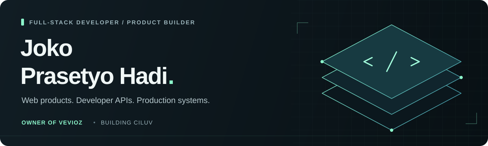

  

  <a href="https://www.vevioz.com/"><strong>Vevioz</strong></a> &nbsp; / &nbsp;
  <a href="https://api.vevioz.com/"><strong>Developer API</strong></a> &nbsp; / &nbsp;
  <a href="https://github.com/vevioz"><strong>Public work</strong></a> &nbsp; / &nbsp;
  <a href="mailto:admin@vevioz.com"><strong>Get in touch</strong></a>

## Hi, I'm Jok.

**Full-stack developer, product builder, and owner of [Vevioz](https://www.vevioz.com/).**

I build and operate web products, developer APIs, and the infrastructure behind them. My work connects the interface people use with the services that keep it running.

I care about clear user experiences, dependable releases, and software that is practical to maintain. I use AI-assisted development to turn product ideas into working systems, with testing and production verification as part of the process.

### What I'm building

| Project | Focus | Explore |
| :--- | :--- | :--- |
| **Vevioz** | Social networking and web experiences | [Website](https://www.vevioz.com/) |
| **Vevioz API** | Media processing, REST APIs, and embeddable integrations | [API & documentation](https://api.vevioz.com/) |
| **CILUV** | A new product across web and mobile | In development |

### Across the stack

| Layer | My focus |
| :--- | :--- |
| **Frontend** | Responsive interfaces, accessible layouts, browser integrations, and media experiences |
| **Backend** | APIs, service integration, background processing, and application logic |
| **Infrastructure** | Linux, reverse proxies, edge delivery, and production operations |
| **Delivery** | Git, CI/CD, regression checks, monitoring, and rollback planning |

**Languages & web** &nbsp; `JavaScript` `HTML` `CSS` `PHP` `Go` `Python`

**Systems & delivery** &nbsp; `Linux` `NGINX` `Cloudflare` `Git` `GitHub Actions`

### Explore my public work

- **[Vevioz API integrations](https://github.com/vevioz/Super-Fast-Free-YouTube-to-MP3-and-MP4-Converter-API)** — public API documentation and integration examples.
- **[Browser integration](https://github.com/jokoprasetyohadi/chrome)** — a browser-focused media integration project.
- **[Embeddable APIs](https://github.com/jokoprasetyohadi/apis)** — button and iframe integration examples.
- **[Media player](https://github.com/jokoprasetyohadi/youtubeplayer)** — a web media-player integration.

My public repositories include earlier experiments and integrations alongside current work. They are a record of what I've explored, not a promise that every older project is actively maintained.

### How I work

**Understand the product. Build the right thing. Verify it in production.**

- Start with the user experience and a clear product requirement.
- Make small, reviewable changes with a recovery path.
- Measure behavior, investigate failures, and improve the system.

---

  <strong>From the first interface to the production release.</strong> 
  <a href="https://www.vevioz.com/">vevioz.com</a> &nbsp; · &nbsp;
  <a href="https://api.vevioz.com/">api.vevioz.com</a> &nbsp; · &nbsp;
  <a href="mailto:admin@vevioz.com">admin@vevioz.com</a>

